<div align="center">

# SENTINEL AI

### Autonomous Infrastructure Intelligence

Monitor infrastructure, investigate incidents and coordinate governed remediation from one interface.

<p>
  
  
  
  
  
  
  
</p>

[Repository](https://github.com/rajnikantdhardwivedi7/sentinel-ai) ·
[Architecture](docs/ARCHITECTURE.md) ·
[Security](docs/SECURITY.md) ·
[Development notes](docs/DEVELOPMENT.md)

</div>

---

SENTINEL AI is an infrastructure intelligence platform. It helps engineering teams understand operational failures, investigate anomalies, review security signals and coordinate controlled remediation through one interface.

> [!IMPORTANT]
> SENTINEL AI is currently an evolving MVP. Features and integrations must be evaluated according to their documented implementation status. Much of the platform runs on **simulated** telemetry; see [Demo mode and limitations](#demo-mode-and-limitations).

## Table of contents

- [Screenshots](#screenshots)
- [Overview](#overview)
- [Key features](#key-features)
- [Architecture](#architecture)
- [Incident lifecycle](#incident-lifecycle)
- [Technology stack](#technology-stack)
- [Project structure](#project-structure)
- [Installation](#installation)
- [Configuration](#configuration)
- [Usage](#usage)
- [Security model](#security-model)
- [Demo mode and limitations](#demo-mode-and-limitations)
- [Testing](#testing)
- [Roadmap](#roadmap)
- [Contributing](#contributing)
- [Acknowledgments](#acknowledgments)
- [License](#license)
- [Author](#author)

## Screenshots

All screenshots were captured from the running application at 1440×900.

**Landing page:** the product overview with a live capture of the Command Center.

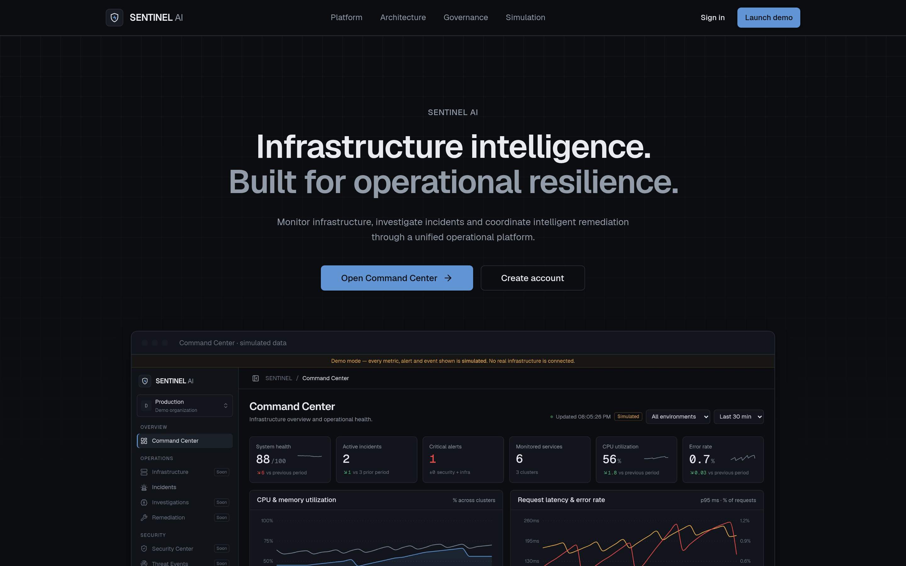

**Command Center, DEMO mode:** simulated KPIs, utilization, latency and error-rate charts, incidents, agent activity and infrastructure health. The banner and "Simulated" tags mark every synthetic value.

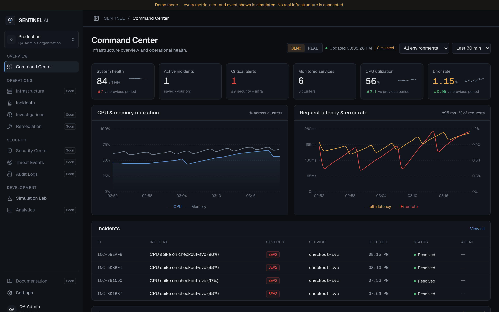

**Command Center, REAL mode:** metrics scraped from a real Prometheus instance (the public PromLabs demo). It shows the source URL, connection status, last successful scrape, per-metric timestamps, target health and incidents raised by real threshold violations.

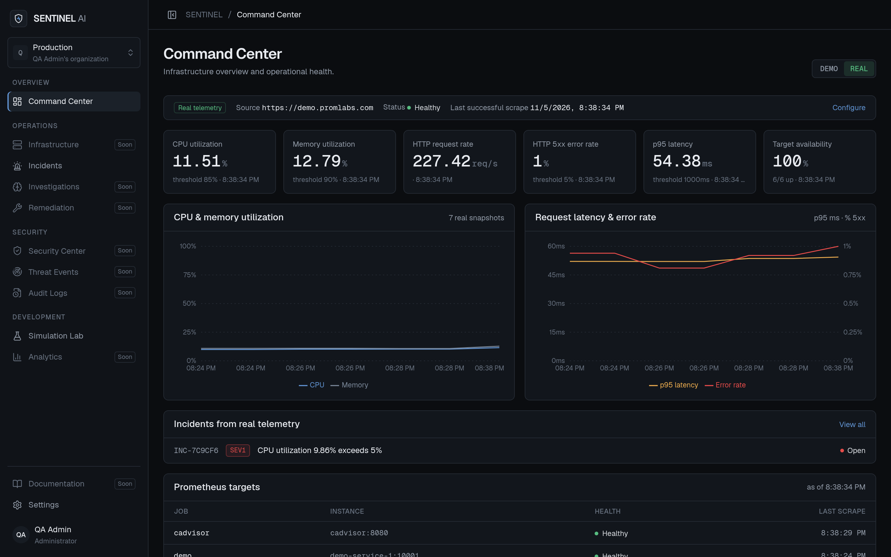

**Incident management:** search and filter incidents. Each row is labelled as simulated or real telemetry.

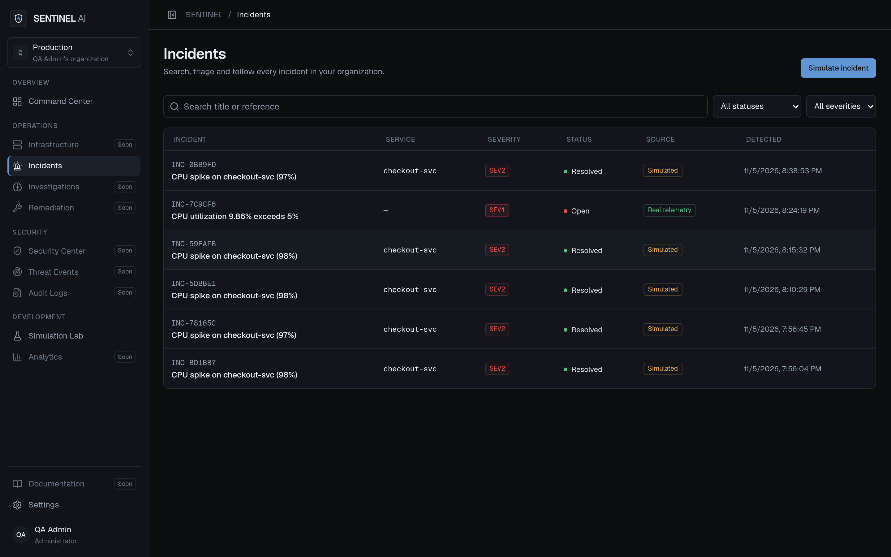

**Simulation Lab:** starts the simulated CPU-spike lifecycle against seeded infrastructure.

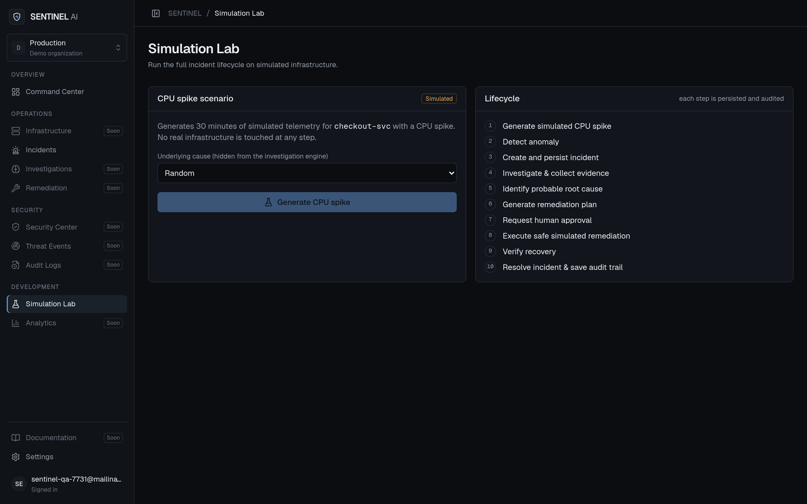

**Investigation:** a staged, rule-based investigation with an evidence summary, a ranked root-cause hypothesis and a confidence score.

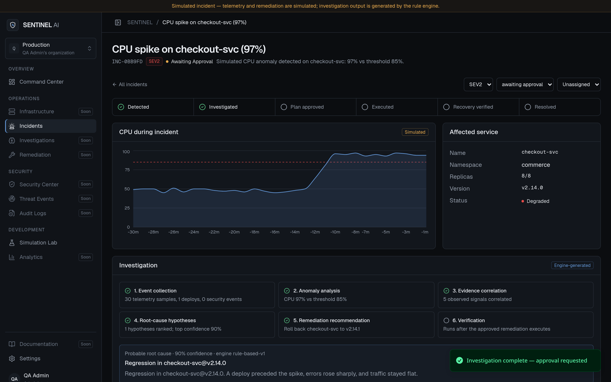

**Remediation approval:** the proposed plan with steps and risk, waiting for an explicit human decision. Below it is the attributed audit trail.

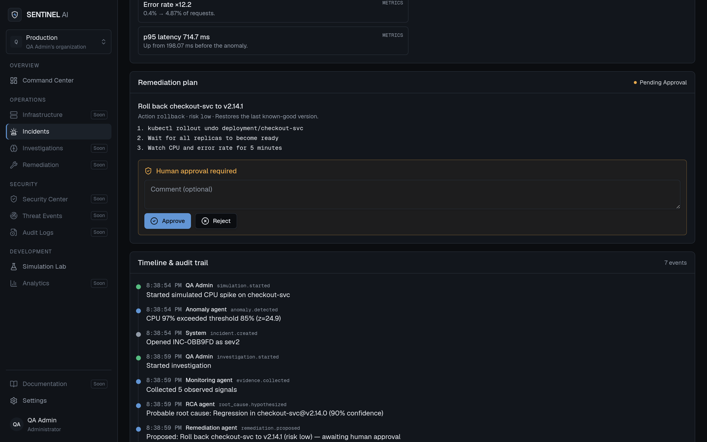

**Verified recovery (simulated):** the incident after approval, simulated execution and recovery verification.

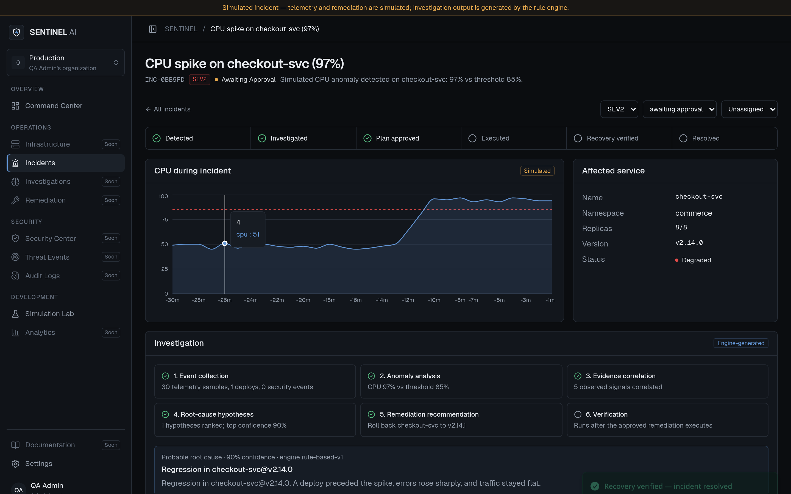

**Monitoring settings:** Prometheus endpoint, read-only credential, editable PromQL, alert thresholds, cooldown, connection test and manual scrape.

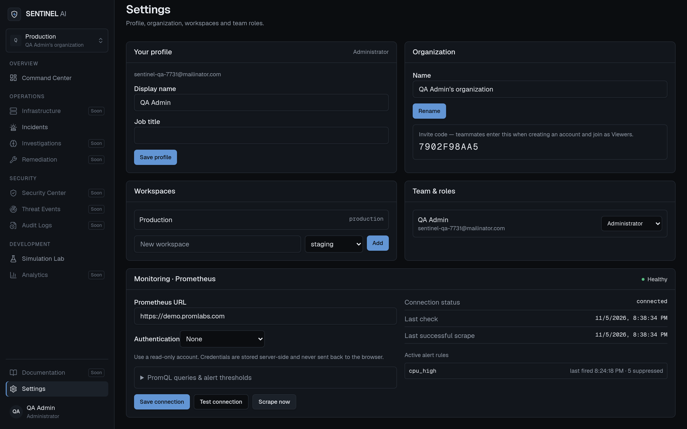

## Overview

**What it is.** A web platform that connects incidents, evidence, remediation plans, human approvals and audit history in one workflow.

**Why it exists.** During an incident, engineers jump between dashboards, alert channels, runbooks and chat to rebuild what happened. SENTINEL AI keeps detection, investigation, decision and verification together and records every step.

**Who it is for.** SRE, platform and security engineers who need fixes that are explained, attributable and approved before they run.

**Design principles**
- **Evidence before action.** Observed signals are kept separate from inferred hypotheses.
- **Humans approve changes.** The database enforces the approval workflow, not just the UI.
- **Honest data provenance.** Every metric and incident is labelled as simulated or real.

**Monitoring dashboards vs. infrastructure intelligence.** A dashboard shows signals. An intelligence platform also connects those signals to an incident, a probable cause, a proposed action, a decision and a verified outcome. SENTINEL AI does **not** replace Prometheus, Grafana, PagerDuty or a SIEM. It reads from monitoring systems such as Prometheus and coordinates what happens next.

## Key features

### Implemented

| Feature | Notes |
|---|---|
| Authentication | Email/password with confirmation and reset, Google, Sign in with Lovable |
| Organizations, workspaces, invite codes | Multi-tenant; every record is organization-scoped |
| Role-based access control | Administrator, SRE Engineer, Security Analyst, Viewer, enforced by RLS |
| Incident management | List, search, filter, severity/status/assignee updates, detail view |
| Governed remediation workflow | Propose → approve/reject → execute → verify, with database-enforced transitions |
| Audit trail | Every lifecycle step is recorded with the acting user or agent label |
| Prometheus integration | Connection config, test, PromQL scrape (CPU, memory, request rate, 5xx rate, p95 latency, target health, availability), snapshots |
| Threshold alerting | Configurable thresholds, incidents from real violations, deduplication with cooldown |
| DEMO / REAL environment switch | REAL never falls back to simulated values |

### Partially implemented

| Feature | Current state |
|---|---|
| Investigation and root-cause analysis | Deterministic rule engine (`rule-based-v1`). No LLM inference. Runs only on simulated incidents. |
| Remediation execution | Updates database records only. No real infrastructure is changed. |
| Recovery verification | Checks **simulated** post-fix telemetry. |
| Command Center (DEMO) | Charts, KPIs, agent feed, clusters and services are synthetic. |
| Security events | Seeded sample events are used as investigation input; no live source. |
| Scheduled scraping | A 5-minute schedule exists but only runs on the published app. |

### Planned

Infrastructure explorer, Security Center, Analytics, Kubernetes monitoring, OpenTelemetry ingestion, Falco events, LLM-assisted investigation, multi-agent orchestration, two-person approval, real remediation executors.

## Architecture

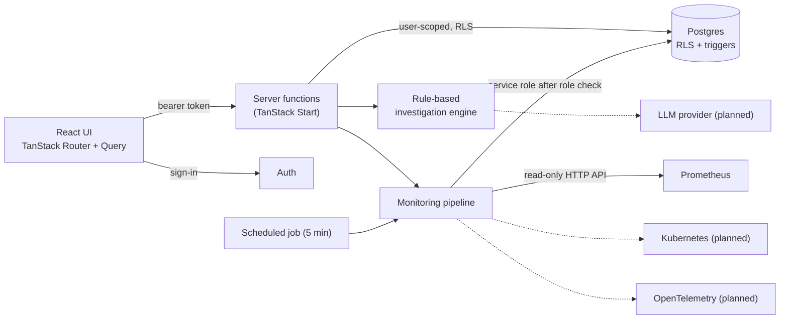

Solid lines are implemented; dashed lines are planned. Full details are in [docs/ARCHITECTURE.md](docs/ARCHITECTURE.md).

## Incident lifecycle

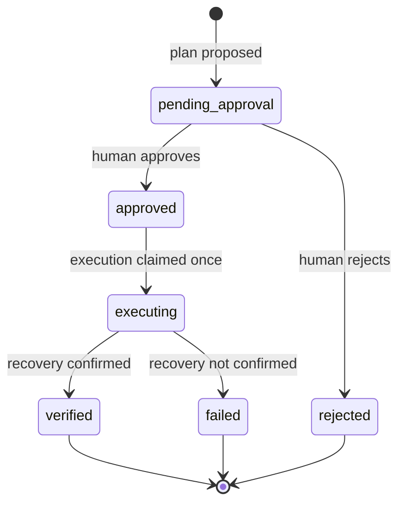

| # | Step | Simulated lifecycle | Real (Prometheus) |
|---|---|---|---|
| 1 | Event generation / ingestion | Synthetic CPU spike | PromQL scrape |
| 2 | Anomaly detection | z-score + threshold | Configurable thresholds |
| 3 | Incident creation | Yes | Yes, with cooldown dedup |
| 4–6 | Investigation, evidence, root-cause hypothesis | Rule engine | Not yet |
| 7 | Remediation proposal | Rule engine (rollback, scale out, restart) | Not yet |
| 8 | Approval | Human, recorded | n/a |
| 9 | Execution | **Simulated** (database only) | n/a |
| 10 | Recovery verification | **Simulated** telemetry | n/a |
| 11 | Audit history | Yes | Yes |

The database rejects any transition outside the diagram:
- Approval or rejection requires a recorded decision.
- Each plan gets exactly one decision.
- Finished plans cannot change.
- Approve and execute are atomic, so the same step can't run twice.

## Technology stack

| Area | Technologies |
|---|---|
| Frontend | React 19, TanStack Router, TanStack Query, Tailwind CSS 4, Radix UI / shadcn components, lucide-react |
| Backend | TanStack Start v1 server functions and server routes (Cloudflare Worker runtime), Zod validation |
| Database | PostgreSQL (Supabase via Lovable Cloud), RLS, triggers, plain-SQL migrations via Drizzle Kit |
| Authentication | Supabase Auth, Google and Lovable OAuth |
| AI / orchestration | Deterministic TypeScript rule engine behind an `InvestigationProvider` interface (no LLM yet) |
| Visualization | Recharts |
| Monitoring | Prometheus HTTP API (read-only) |
| Testing | Vitest, Testing Library, jsdom |
| Build / deploy | Vite, Lovable hosting |

Planned (not in the codebase): Kubernetes client, OpenTelemetry, Falco, Grafana, LLM provider.

## Project structure

```text
.
├── docs/
│   ├── ARCHITECTURE.md
│   ├── DEVELOPMENT.md
│   ├── SECURITY.md
│   └── assets/screenshots/      # README screenshots from the running app
├── drizzle/migrations/          # SQL schema, grants, RLS policies, triggers
├── public/
├── src/
│   ├── components/
│   │   ├── sentinel/            # AppShell, Logo, RealCommandCenter, MonitoringSettings
│   │   └── ui/                  # shadcn/Radix primitives
│   ├── hooks/                   # use-session, use-mobile
│   ├── integrations/            # generated Supabase + Lovable auth clients
│   ├── lib/
│   │   ├── sentinel.functions.ts    # incidents, lifecycle, org/members server functions
│   │   ├── monitoring.functions.ts  # Prometheus config/test/scrape server functions
│   │   ├── prometheus.server.ts     # server-only Prometheus client + pipeline
│   │   ├── monitoring.ts            # pure parsing, rules, cooldown, URL guard
│   │   ├── investigation-engine.ts  # rule-based detection and RCA
│   │   ├── remediation-state.ts     # state machine (mirrors DB trigger)
│   │   ├── permissions.ts           # role → permission matrix
│   │   └── demo-telemetry.ts        # DEMO-mode synthetic data
│   ├── routes/
│   │   ├── index.tsx, dashboard.tsx, auth.tsx, reset-password.tsx
│   │   ├── _authenticated/      # incidents, incident detail, simulation, settings
│   │   └── api/public/jobs/     # scheduled Prometheus scrape endpoint
│   └── test/                    # Vitest suites
├── supabase/config.toml
├── .env.example
├── package.json
└── vite.config.ts
```

## Installation

**Prerequisites**
- Node.js 20.19+ or 22.12+ (required by Vite 8).
- npm, or Bun (a `bun.lock` is committed).
- A Supabase project, or the Lovable Cloud backend the project was built on.

```bash
git clone https://github.com/rajnikantdhardwivedi7/sentinel-ai.git
cd sentinel-ai
npm install                 # or: bun install
cp .env.example .env        # fill in your project's values
```

**Database.** Apply the SQL files in `drizzle/migrations/` to your Postgres database in numeric order (for example with `psql` or the Supabase SQL editor). They create every table, grant, RLS policy and trigger. New sign-ups automatically get an organization with seeded simulated infrastructure.

```bash
npm run dev       # development server
npm run build     # production build
npm run preview   # serve the build locally
npm test          # run the test suite once
npm run lint
```

## Configuration

| Variable | Purpose | Required | Example |
|---|---|---|---|
| `VITE_SUPABASE_URL` | Backend URL used by the browser | Yes | `https://your-project-ref.supabase.co` |
| `VITE_SUPABASE_PUBLISHABLE_KEY` | Publishable (browser-safe) key | Yes | `sb_publishable_...` |
| `VITE_SUPABASE_PROJECT_ID` | Project reference | Yes | `your-project-ref` |
| `SUPABASE_URL` | Backend URL for server code | Yes | `https://your-project-ref.supabase.co` |
| `SUPABASE_PUBLISHABLE_KEY` | Publishable key for server code | Yes | `sb_publishable_...` |
| `SUPABASE_PROJECT_ID` | Project reference for server code | Yes | `your-project-ref` |
| `SUPABASE_SERVICE_ROLE_KEY` | Server-only privileged key for monitoring config, credentials and scheduled scrapes | For monitoring | *(never commit)* |
| `LOVABLE_CRON_SECRET` | Bearer secret that authorizes `/api/public/jobs/scrape-prometheus` | For scheduled scrapes | *(random string)* |

Prometheus endpoints, credentials, queries and thresholds are configured per organization in **Settings → Monitoring**, not through environment variables.

## Usage

1. **Create an account.** You become Administrator of a new organization with seeded demo infrastructure.
2. **Open Simulation Lab → Generate CPU spike.** This creates an incident.
3. **Run the investigation.** On the incident page, choose **Run investigation**, review the evidence and hypothesis, then approve or reject the plan.
4. **Execute the approved plan.** Execution is simulated. Recovery is verified, the incident resolves, and the timeline shows every step.
5. **Connect Prometheus (optional).** In **Settings → Monitoring**, enter a Prometheus URL, test it and run **Scrape now**.
6. **Switch to REAL.** In the Command Center, use the **REAL** switch to see only real telemetry.
7. **Invite teammates.** Share the invite code from Settings; teammates join as Viewers.

## Security model

- Server-side authentication on every server function.
- Four roles stored in a dedicated table.
- Organization-scoped row-level security.
- Database-enforced remediation transitions.
- One decision per plan.
- Atomic approve/execute.
- Attributed, append-only audit inserts.
- Service-role-only credential storage.
- An SSRF guard on Prometheus URLs.

**Two-person (independent) approval is not implemented.** See [docs/SECURITY.md](docs/SECURITY.md) for the full permission matrix, what was verified and the known limitations.

## Demo mode and limitations

| Question | Answer |
|---|---|
| Is Command Center data simulated? | In **DEMO** mode, yes, entirely. In **REAL** mode it comes only from Prometheus. |
| Do investigations use an LLM? | No. A deterministic rule engine. |
| Are the "agents" independent processes? | No. They are workflow stage labels in the audit trail. |
| Does remediation change real infrastructure? | No. It only updates database records. |
| Is Prometheus connected? | Yes, when configured. Verified against the public PromLabs demo instance, not a production cluster. |
| Is Kubernetes connected? | No. |
| Does recovery verification use real monitoring data? | No. It uses simulated telemetry. |

Other limitations:
- Real metrics are cluster-wide aggregates, so real incidents are not linked to a service.
- Lifecycle steps are not transactional.
- Old metric snapshots are never deleted yet.
- The Infrastructure, Security Center, Analytics and Documentation pages are not built.

## Testing

Framework: **Vitest** with jsdom and Testing Library. There are **42 automated tests in 5 suites**:

| Suite | Covers |
|---|---|
| `permissions.test.ts` | Role → permission matrix for all four roles |
| `remediation-state.test.ts` | Allowed and forbidden remediation transitions |
| `investigation-engine.test.ts` | Anomaly detection, root-cause ranking, plan selection, recovery check |
| `monitoring.test.ts` | Prometheus parsing, missing/malformed data, thresholds, cooldown, URL guard, and the client against mocked success, 401, unreachable and non-Prometheus responses |
| `app-routing.test.tsx` | Route tree sanity |

```bash
npm test
```

The end-to-end incident lifecycle and the database bypass attempts were exercised manually in a browser against the preview backend. They are not part of the automated suite.

**Not yet covered:**
- Automated end-to-end tests.
- RLS policy tests in CI.
- Non-admin role walkthroughs.
- OAuth and email flows.

## Roadmap

**Completed**
- [x] Authentication, organizations, workspaces, invite codes
- [x] Four-role RBAC with row-level security
- [x] Incident management and the simulated end-to-end lifecycle
- [x] Database-enforced remediation state machine and attributed audit trail
- [x] Prometheus integration, threshold incidents and alert cooldown
- [x] DEMO / REAL environment separation

**In progress**
- [ ] Per-service real metrics and investigations on real snapshots
- [ ] Workspace-scoped data views

**Planned**
- [ ] Independent two-person remediation approval
- [ ] Transactional lifecycle operations
- [ ] Kubernetes monitoring
- [ ] OpenTelemetry ingestion
- [ ] Falco security integration
- [ ] LLM-assisted investigation via the `InvestigationProvider` interface
- [ ] Multi-agent orchestration
- [ ] Real, guarded remediation executors
- [ ] Infrastructure explorer, Security Center, analytics and reporting
- [ ] Rate limiting, invite expiry, snapshot retention

## Contributing

1. Fork the repository and create a branch: `git checkout -b feat/short-description`.
2. Follow the conventions in [`AGENTS.md`](AGENTS.md):
   - Server logic goes in `*.functions.ts` with Zod validation.
   - Permissions must mirror RLS.
   - Pages render inside `AppShell`.
   - Use semantic design tokens only.
3. Add or update tests for any rule you change, and run `npm test` and `npm run lint`.
4. Use clear, imperative commit messages (for example `fix: reject approval on non-pending plan`).
5. Open a pull request describing the change, how you verified it, and any new limitations.

Report bugs and request features through [GitHub Issues](https://github.com/rajnikantdhardwivedi7/sentinel-ai/issues). For bugs, include steps to reproduce, expected vs. actual behaviour, and whether you were in DEMO or REAL mode.

## Acknowledgments

[TanStack](https://tanstack.com) · [React](https://react.dev) · [Supabase](https://supabase.com) · [Prometheus](https://prometheus.io) and the [PromLabs demo](https://demo.promlabs.com) · [Tailwind CSS](https://tailwindcss.com) · [Radix UI](https://www.radix-ui.com) · [shadcn/ui](https://ui.shadcn.com) · [Recharts](https://recharts.org) · [Lucide](https://lucide.dev) · [Vitest](https://vitest.dev) · [Lovable](https://lovable.dev)

## License

No license file has been added yet. Until one is, all rights are reserved by the author, and the code is not offered under an open-source license.

## Author

**Rajnikant Dhar Dwivedi**

[GitHub](https://github.com/rajnikantdhardwivedi7) · [Portfolio](https://rajnikantdhardwivedi-mu.vercel.app/) · [Kaggle](https://www.kaggle.com/rajnikantdhardwivedi)
