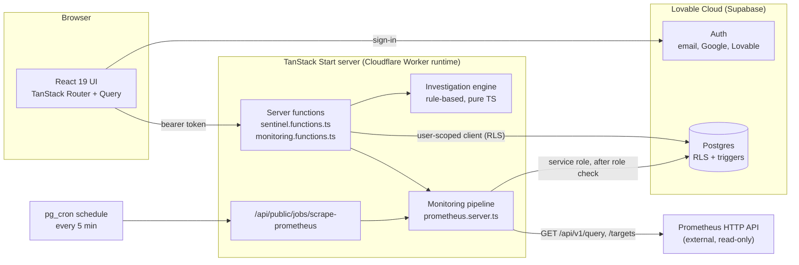
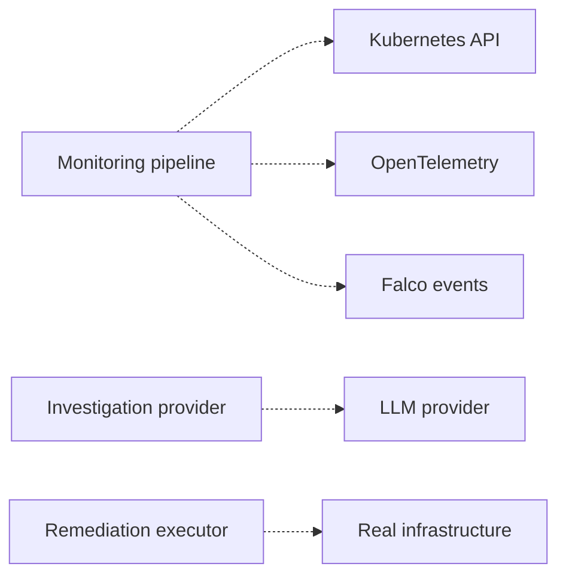

# Architecture

This document describes what is **implemented today**. Planned components are listed separately and marked as such.

## Components

### Planned (not implemented)

## Layers

| Layer | Location | Notes |
|---|---|---|
| Routes / pages | `src/routes/` | `/`, `/dashboard`, `/auth`, `/reset-password` are public; `/_authenticated/*` (incidents, simulation, settings) requires sign-in. |
| App shell & UI primitives | `src/components/sentinel/AppShell.tsx` | Sidebar, page header, `Panel`, `StatusPill`, `SeverityBadge`, `SourceTag`, `EmptyState`. |
| Server functions | `src/lib/sentinel.functions.ts`, `src/lib/monitoring.functions.ts` | `createServerFn` + `requireSupabaseAuth`, Zod-validated input. |
| Permissions | `src/lib/permissions.ts` | Role → permission matrix, mirrored by RLS policies. |
| Investigation engine | `src/lib/investigation-engine.ts` | Deterministic anomaly detection (z-score), hypothesis ranking, remediation plan selection. Behind an `InvestigationProvider` interface. |
| Remediation state machine | `src/lib/remediation-state.ts` + DB trigger | Database is authoritative. |
| Monitoring | `src/lib/monitoring.ts` (pure), `src/lib/prometheus.server.ts` (I/O) | Validation, normalization, threshold rules, cooldown, URL guard. |
| Demo data | `src/lib/demo-telemetry.ts` | Deterministic synthetic metrics for DEMO mode only. |
| Schema | `drizzle/migrations/*.sql` | Plain SQL migrations (tables, grants, RLS, triggers). |

## Data model (main tables)

`organizations`, `workspaces`, `profiles`, `user_roles`, `clusters`, `services`, `infrastructure_resources`, `incidents`, `security_events`, `simulation_runs`, `investigations`, `investigation_evidence`, `remediation_plans`, `remediation_approvals`, `audit_logs`, `monitoring_connections`, `monitoring_credentials`, `metric_snapshots`, `alert_states`.

Every row carries `organization_id`; RLS restricts reads to `current_org()`.

## Data flows

**Simulated lifecycle**
1. The server generates synthetic CPU telemetry.
2. The detector checks it and an incident is created.
3. The rule engine produces evidence and a plan.
4. A person records a decision.
5. Execution is simulated.
6. Synthetic recovery is checked.
7. The incident is resolved, with an audit row written at every step.

**Real monitoring**
1. A scheduled job or **Scrape now** runs a PromQL query for each metric and reads the target list.
2. The responses are validated and normalized.
3. A row is written to `metric_snapshots`.
4. Threshold rules are evaluated.
5. `alert_states` cooldown is checked.
6. A `source = real` incident is created and an audit row written.

**Display**
- The Command Center **DEMO** mode reads `demo-telemetry.ts`.
- **REAL** mode reads only `metric_snapshots`. If the last scrape failed, it shows a disconnected state instead of values.
